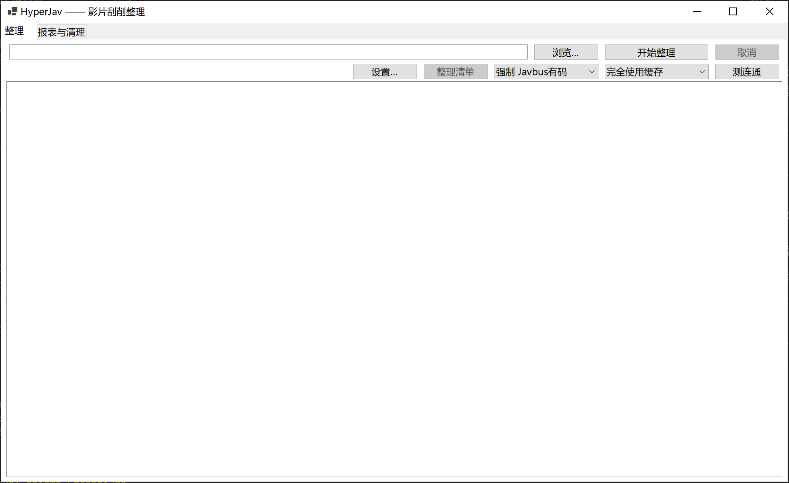

# HyperJav

HyperJav 是一个 Windows 桌面端影片刮削与整理工具，用于把已经下载到本地的影片整理成适合 Kodi、Emby、Jellyfin 等媒体库使用的结构。

主要能力：

- 从文件名识别车牌和影片类型：有码、无码、素人、FC2
- 识别中字、流出标记
- 从多个站点刮削标题、演员、片商、系列、发行日期、简介、评分、标签、封面等信息
- 生成兼容 Kodi/Emby/Jellyfin 的 NFO
- 重命名影片、字幕和文件夹
- 下载海报和 fanart，可选添加“中字 / 无码流出”条幅
- 按影片类型、演员等规则归类
- 本地刮削缓存、入库流水和 HTML 入库报表
- 扫描并清理指定目录下的小文件



> **使用范围**：本工具仅用于整理你个人合法持有的媒体文件，不提供、不下载、不分发任何影片内容。请遵守所在地区的法律法规。首次整理前建议先备份目标目录。整理会重命名和移动文件，文件清理功能会**永久删除**文件且不进回收站。

---

## 1. 运行要求

- Windows 10 / 11
- 如果使用框架依赖版发布包，需要安装 **.NET 10 Desktop Runtime**
- 刮削时需要网络；部分站点通常需要代理
- 程序目录必须可写，因为配置、缓存、日志和整理清单都写在 exe 同目录

建议把程序解压到普通文件夹，例如 `D:\Tools\HyperJav`，不要放在 `C:\Program Files` 等默认只读目录。

---

## 2. 安装与启动

### 使用发布包

解压后目录应类似：

```text
HyperJav.App.exe
整理规则.ini
data/
  feature-dictionary.json
  suren-prefixes.json
  translations.json          # 可选
```

双击 `HyperJav.App.exe` 启动。

也可以直接用命令打开设置窗口：

```powershell
HyperJav.App.exe --settings
```

### 从源码运行

需要 .NET 10 SDK：

```powershell
dotnet build HyperJav.slnx
dotnet run --project src/HyperJav.App
```

发布：

```powershell
dotnet publish src/HyperJav.App -c Release -o publish
```

发布目录必须包含运行资产：

```text
publish/
  HyperJav.App.exe
  整理规则.ini
  data/
    feature-dictionary.json
    suren-prefixes.json
```

如果 `data/` 中缺少 `feature-dictionary.json`，程序仍能启动，但特征不会规范化；缺少 `suren-prefixes.json` 时素人前缀识别会失效。

### 使用 GitHub Actions 构建

仓库内置两个工作流：

- `.github/workflows/ci.yml`：推送到 `master`/`main` 或提交 PR 时自动构建并运行测试，失败时会保留测试结果。
- `.github/workflows/release.yml`：推送 `v*` 标签（例如 `v1.0.0`）时构建两种 win-x64 压缩包并创建 GitHub Release；也可以在 Actions 页面手动触发，填写标签后同样会创建 Release，留空则只生成构建产物。

发布包分为两种：

- `HyperJav-<版本>-win-x64-self-contained.zip`：自带 .NET 运行时，解压即可运行，体积较大。
- `HyperJav-<版本>-win-x64-framework-dependent.zip`：体积较小，需要安装 .NET 10 Desktop Runtime。

两个包都已包含 `整理规则.ini` 和 `data/` 运行资产。

---

## 3. 快速开始

1. 把待整理影片放在一个目录下。
   - 程序会递归扫描所选目录。
   - 通常一个影片一个文件夹；直接放在根目录下的视频也支持。
   - 文件名中应包含车牌，例如 `ABP-123.mp4`、`SSIS-001 中字.mkv`、`FC2-PPV-1234567.mp4`。
2. 打开 HyperJav，在“整理”页选择目标目录。
   - 如果目标是磁盘根目录，程序会再次确认，避免误操作。
3. 在“刮削源”下拉框中选择：
   - **自动（失败回退）**：推荐，按影片类型选择站点，失败时自动尝试下一个候选。
   - **强制某站**：只用指定站点，适合核对或该站已有数据时。
4. 选择刮削缓存等级，默认“完全使用缓存”。
5. 点击 **开始整理**。
6. 等待日志输出。结束后会显示：
   - OK：完成
   - 注意：完成但存在缺封面、跳过视频重命名等情况
   - 跳过：已有 NFO、未识别车牌或未收录
   - 错误：网络、IO 或解析失败
7. 点击 **整理清单** 可以定位本次生成的清单文件。

如果整理中断或想增量处理，可以打开设置中的“跳过已存在 nfo 的文件夹”，再次整理时已处理过的文件夹会直接跳过。

取消按钮不会立即中断当前影片夹，程序会在当前影片文件夹处理结束后停止。

---

## 4. 整理后会得到什么

默认情况下，一个影片文件夹可能变成：

```text
ABP-123 示例标题/
  ABP-123 示例标题.mp4
  ABP-123 示例标题.nfo
  ABP-123 示例标题-poster.jpg
  ABP-123 示例标题-fanart.jpg
  ABP-123 示例标题.srt
```

具体行为取决于设置：

- **重命名影片**：默认格式为 `车牌+空格+标题`。
- **修改文件夹**：默认格式为 `车牌+【全部演员】`。
- **NFO**：默认标题格式为 `车牌+空格+标题`，写入 title、演员、片商、系列、发行日期、评分、标签等字段。
- **封面**：默认生成 `视频名-poster.jpg` 和 `视频名-fanart.jpg`。
- **条幅**：可选中字条幅（默认 `㊥`）和无码流出条幅（默认 `无码流出`）。
- **字幕**：默认跟随视频改名。
- **多 CD**：同一车牌多个视频会从第 2 部开始追加 `-cdN`。
- **多车牌文件夹**：夹内存在多个不同车牌时，跳过文件夹级改名/建夹/归类，但逐文件的重命名、NFO 和封面仍会执行。
- **归类**：启用后会按设置的分类模板移动影片或整个影片夹。

整理清单、缓存和报表不会写入影片目录：

- 整理清单：`data/整理清单/整理清单-时间戳.txt`
- 入库流水：`data/logs/入库流水-*.log`
- HTML 报表：`data/reports/入库明细报表-*.html`

需要提示特征未命中、缺封面等问题时，警告会写在对应影片文件夹内的 `警告信息.txt`。

---

## 5. 刮削源与自动回退

当前支持 5 个刮削源：

| 影片类型 | 自动模式候选顺序 | 说明 |
|---|---|---|
| 有码 | Javlibrary → Javbus 有码 | Javlibrary 失败或被拦截时回退 Javbus |
| 无码 | Javbus 无码 | 使用无码站点 |
| 素人 | Jav321 | 通常需要代理 |
| FC2 | JavDb FC2 | 使用 FC2 编号检索 |

“自动（失败回退）”适合大多数情况。只有在你明确知道某个站点有数据，或想减少请求时，才使用“强制某站”。

站点改版、反爬策略、代理节点质量都会影响刮削结果。遇到问题时可以先点 **测连通**，它会逐站检查入口是否可达，但“连通”只代表站点能访问，不代表一定能搜到指定车牌。

---

## 6. 设置说明

所有设置保存在 exe 同目录的 `整理规则.ini`。大多数选项可以通过“设置…”窗口修改，保存后立即生效。

### 收集 NFO

- 跳过已存在 NFO 的文件夹
- 是否收集 NFO
- NFO 中 title 的格式
- 是否去除标题末尾的演员姓名
- 是否把特征写入 genre / tag

### 重命名与文件夹

- 是否重命名影片
- 重命名格式
- 是否创建或重命名独立文件夹
- 新文件夹格式

模板支持的元素包括：车牌、标题、全部演员、原文件名、原文件夹名、系列、片商、发行日期、影片类型、视频等。

### 归类影片

- 是否启用归类
- 针对文件还是文件夹
- 归类根目录
- 归类标准，例如 `影片类型\全部演员`

默认关闭。启用前建议先用少量样本确认路径结构。

### 下载封面

- 是否下载海报
- 海报和 fanart 文件名格式
- 中文字幕条幅
- 无码流出条幅

图床防盗链、代理或网络问题可能导致缺图。缺图只会产生“注意”或警告，不会中断整理。

### 字幕与多 CD

- 是否重命名字幕
- 是否跳过已有字幕的影片
- 多 CD 是否只收集一份 NFO/图片

### 信息来源与网络

- 刮削源：自动或强制单站
- 是否收集 Javlibrary 网友热评
- 是否优先使用 Javbus 图片
- 是否忽略 SSL 证书
- 各站点网址
- 局部代理：填写 `socks5://host:port` 或 `http://host:port`，协议省略时默认 socks5
- 可按站点分别开关代理：Javlibrary、Javbus、Jav321、JavDb、DMM 图片

### 其他

- 简繁中文：影响特征显示
- 扫描文件类型：默认 `mp4、mkv、avi、wmv、iso、rmvb、flv、ts`
- 标题长度：50~150，影响文件名/文件夹名/封面名；NFO title 不截断
- 清理文件大小上限：默认 100 MB

---

## 7. 刮削缓存

缓存文件位于：

```text
data/scrape-cache.db
```

三档可选：

| 等级 | 行为 |
|---|---|
| 完全使用缓存 | 读取正缓存和“未收录”负缓存，也写入两者 |
| 只使用正缓存 | 只读取已抓到的元数据；“未收录”会重新访问站点验证 |
| 完全不使用缓存 | 不读不写，每次都访问站点 |

建议：

- 日常整理使用“完全使用缓存”，减少重复请求。
- 站点数据可能变化时使用“只使用正缓存”。
- 核对站点或怀疑缓存有问题时使用“完全不使用缓存”。

正缓存不会被一次“没搜到”覆盖。网络错误也不会写入负缓存，下次仍可重试。

使用“完全不使用缓存”时不会产生入库流水，因此也无法生成入库报表。

---

## 8. 入库报表

进入 **报表与清理** 页，点击 **生成报表**。

- 从 `data/logs/` 的入库流水和 `data/scrape-cache.db` 生成
- 默认统计最近 180 天
- 生成后自动用默认浏览器打开
- 报表是单文件、离线 HTML，不依赖外部资源

报表提供三种视角：

- 入库：新入库、更新、负缓存转正
- 入库 + 使用：额外包含缓存命中
- 仅缓存使用

可以按车牌前缀、片商、系列、演员、特征、类别、来源站、发行年月、流水月份查看和筛选。

### 语言文件

点击 **语言文件** 会打开：

```text
data/translations.json
```

可以对片商、系列、演员、特征、类别的日文原名配置中文显示名。该文件：

- 只影响报表显示，不改数据库，也不改文件夹名
- 缺失项自动回退原文
- 文件损坏时报表仍可生成，但会显示告警

---

## 9. 文件清理

在 **报表与清理** 页可以扫描并删除小文件：

1. 选择清理目录，或点击“同整理目录”。
2. 设置“小于 N MB”的阈值，默认 100 MB。
3. 选择类型：全部、视频、图片、字幕、其他。
4. 点击 **扫描**。
5. 勾选要删除的文件，点击 **删除选中**。

注意：

- 只列出**严格小于**阈值的文件
- 删除是**永久删除**，不进回收站
- 删除前会要求确认
- 隐藏文件、系统文件、符号链接会被跳过
- 无权限的文件/目录会被忽略
- 删除失败会逐条回报，不会中断其他文件

这个功能不会判断文件是否属于当前影片，请务必人工确认后再删除。

---

## 10. 常见问题

### 提示“未收录”

可能原因：

- 车牌识别错误
- 站点确实没有该条目
- 站点搜索规则变化
- 代理不可用

可以尝试切换强制站点、检查代理、点击“测连通”，或换一个样本验证。

### 提示连接被拒绝、超时、代理失败

检查：

1. “局部代理”是否启用
2. `代理服务器` 格式是否正确
3. 对应站点的代理开关是否打开
4. 代理软件/节点是否正常
5. “忽略 SSL 证书”是否已勾选

### 测连通正常，但整理仍然失败

“测连通”只检查入口页，不能保证搜索和详情页结构仍然匹配。站点改版可能导致解析失败；这类问题通常需要更新程序版本。

### 封面缺失

常见原因是图床防盗链、代理未覆盖图片站点或站点临时故障。缺图会记入警告，不会中断其他影片。

### 特征没有变成标准中文

`data/feature-dictionary.json` 缺失或损坏时，特征会保留原始标签。检查文件是否位于 exe 同目录的 `data/` 下。

### 设置保存失败

程序需要写入 exe 同目录的 `整理规则.ini`、`data/` 下的缓存和日志。请把程序放在有写权限的目录。

### 整理后想恢复

程序没有自动撤销功能。整理清单和警告信息可以作为人工排查依据；执行前请备份原目录，尤其是首次大批量整理时。

---

## 11. 目录说明

```text
HyperJav.App.exe
整理规则.ini                  # 配置文件
data/
  feature-dictionary.json      # 特征规范化字典
  suren-prefixes.json          # 素人车牌前缀表
  translations.json            # 报表译名表，可选
  scrape-cache.db              # 刮削缓存，运行后生成
  logs/                        # 入库流水，运行后生成
  reports/                     # HTML 报表，运行后生成
  整理清单/                     # 整理清单，运行后生成
```

请保留 `data/feature-dictionary.json` 和 `data/suren-prefixes.json`，否则刮削结果的规范化和素人识别会退化。
